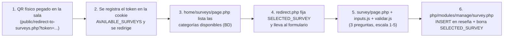

<!-- Si vas a tocar codigo de aca, recorda que esto es LENGUAJE MARKDOWN, antes de TOCAR ALGO busca como es la sintaxis de Markdown
    Es facil igual, pero de todas forma TENE CUIDADO, no vayas a romper algo (Esto es un comentario, no se ve en el codigo) -->

<!-- Aca empieza el Codigo (Despues de este comentario y el de abajo) -->

<!-- Centro los textos tipo titulo -->
<div align="center">

# S.I.G.S.M.
### Sistema informático de Gestión de Servicios Médicos

</div>

<!-- Este es para centrar los cosos estos animados -->
<div align="center">

[-orange?style=for-the-badge&logo=github)](https://github.com/)
[](https://github.com/)
[](https://github.com/)
[](https://github.com/)

</div>

---

## 📋 Tabla de Contenidos:
- [💡 Acerca del Proyecto](#-acerca-del-proyecto)
- [👥 Equipo de Desarrollo (EDSU)](#-equipo-de-desarrollo-edsu)
- [🏗 Arquitectura General del Proyecto](#-arquitectura-general-del-proyecto)
- [🗂 Estructura de Directorios y Archivos](#-estructura-de-directorios-y-archivos)
- [💻 Aplicación Web (PHP / MySQL)](#-aplicación-web-php--mysql)
- [🌐 Sitio Público (flujo del paciente)](#-sitio-público-flujo-del-paciente)
- [📝 Encuestas por Código QR (flujo principal)](#-encuestas-por-código-qr-flujo-principal)
- [🛠 Panel de Administración](#-panel-de-administración)
- [⚡ JavaScript del Proyecto](#-javascript-del-proyecto)
- [🎨 Hojas de Estilo (CSS)](#-hojas-de-estilo-css)
- [🗄 Base de Datos](#-base-de-datos)
- [🔀 Rutas, Navegación y Reescritura de URLs](#-rutas-navegación-y-reescritura-de-urls)
- [🖥 Scripts de Administración del Servidor (Bash)](#-scripts-de-administración-del-servidor-bash)
- [🖥 Máquina Virtual (OVA)](#-máquina-virtual-ova)
- [🐧 Sistemas Operativos y Seguridad (ASO)](#-sistemas-operativos-y-seguridad-aso)
- [🚀 Instalación y Despliegue](#-instalación-y-despliegue)

---

## 🚀 Tecnologías:


---

## 💡 Acerca del Proyecto
**S.I.G.S.M.** es una plataforma web e infraestructura de servidor diseñada para modernizar, digitalizar y resguardar la información del **Hospital de Clínicas**. El sistema combina dos grandes frentes de trabajo desarrollados por el equipo **E.D.S.U.**:

1. **Una aplicación web PHP/MySQL** orientada a dos grupos de usuarios: el **paciente** (que consulta documentos y completa encuestas de reseña de forma anónima mediante códigos QR) y el **personal administrativo/administrador** (que gestiona categorías, documentos y cuentas desde un panel de administración).
2. **Una suite de scripts Bash** para la administración, el endurecimiento (hardening), el respaldo y la auditoría del servidor Ubuntu sobre el que se despliega la aplicación.

Este repositorio corresponde a la rama de desarrollo (**non-stable**) del proyecto: el flujo de encuestas por QR, la gestión de documentos y el panel de administración funcionan de punta a punta, mientras que otras partes (como la gestión de cuentas desde el panel) todavía están en construcción. En la [sección de Estado Actual](#-estado-actual-del-proyecto) se detalla qué está listo y qué falta.

---

## 👥 Equipo de Desarrollo (EDSU)
| Integrante | Rol Principal | Especialidad Técnica |
| :--- | :--- | :--- |
| **Mateo Ducasse** | Admin. de Sistemas / Dev / Tester | Scripts Bash, Hardening SSH (Puertos), Cifrado OpenSSL, Netplan |
| **Ian Galli** | Desarrollador Full Stack | Frontend Responsivo, PHP/MySQL, Mobile-First, QR |
| **Valentin Correa** | Admin. de Base de Datos / Dev | RF/RNF, Modelado Entidad-Relación, Diagramas de Casos de Uso UML, Consultas MySQL |
| **Marcos Salas** | Project Manager / Documentación | Documentación, Diagrama de Gantt, Auditoría de Proyecto |

---

## 🏗 Arquitectura General del Proyecto

La aplicación web está desarrollada en **PHP 8 procedural, sin framework**, con los siguientes pilares técnicos:

| Componente | Tecnología / Mecanismo | Dónde se visualiza |
| :--- | :--- | :--- |
| Lenguaje de servidor | PHP 8.x procedural (sin MVC) | Todo el backend en `php/` y las páginas en `home/` y `dashboard/` |
| Base de datos | MySQL / MariaDB vía **PDO** con consultas **preparadas** | `php/conexion.php` (único punto de conexión) |
| Autenticación | **Sesiones PHP** (`$_SESSION`) | Módulo `php/modules/user/account.php` |
| Flujo público de encuestas | **Cookies** (`AVAILABLE_SURVEYS`, `SELECTED_SURVEY`), **sin sesiones ni login** | `public/`, `home/surveys/` |
| Frontend | HTML + **Bootstrap 5.3.8 (CDN)** + CSS propio + **JavaScript vanilla** | `styles/`, `dashboard/panel/*.js`, `home/surveys/survey/*.js` |
| Manipulación de archivos | `move_uploaded_file()` / `unlink()` sobre `files/documents/` | Módulo `php/modules/manage/document.php` |
| Servidor web | Apache (XAMPP en desarrollo, en producción dentro de la VM) | `.htaccess` en `home/` |
| Administración del servidor | GNU Bash + OpenSSL + UFW + sshd | `ASO-Script/` y `Script(SERVIDOR)/` |

### Patrón general de las páginas
- Cada página PHP es un documento HTML completo generado del lado del servidor: **no existe un sistema de plantillas ni de rutas centralizadas**; cada página construye su propio `<head>` y redacción de rutas relativas (`../../`).
- Los **formularios** apuntan a los módulos de `php/modules/`, que procesan el `POST`, ejecutan lo que corresponda contra la base de datos y terminan con una redirección `header("Location: ...")` de regreso a la página que originó la acción.
- El **panel de administración** (`dashboard/panel/page.php`) funciona como una **SPA por secciones**: una única página que carga todo el contenido de la BD y lo inyecta en variables globales de JavaScript, cediendo al navegador la alternancia visual entre pestañas sin recargar la página.

### Separación de responsabilidades (frontend / backend)
```
Página (home/ o dashboard/)  --POST-->  Módulo PHP (php/modules/)  --PDO-->  MySQL (hospital)
        ^                                      |
        |__________ header("Location: ...") ____|
```
El único componente con lógica de negocio reutilizable es `php/conexion.php`. No existe una capa de modelos; los módulos contienen las consultas SQL directamente.

---

## 🗂 Estructura de Directorios y Archivos

```text
S.I.G.S.M.-Project/
├── README.md                          # Documentación del proyecto (este archivo, versión (2))
├── validar.js                         # Validaciones de la maqueta previa del panel (quedó en la raíz)
│
├── home/                              # SITIO PÚBLICO (pacientes)
│   ├── .htaccess                      # Reescritura de URLs (oculta la extensión .php)
│   ├── main.php                       # Página de inicio (landing del hospital)
│   ├── login/
│   │   ├── page.php                   # Inicio de sesión
│   │   └── test.php                   # Maqueta de rediseño del login (login-wrapper / login-box)
│   ├── documents/
│   │   └── page.php                   # Documentos por categoría (acordeón)
│   └── surveys/
│       ├── page.php                   # Listado de encuestas disponibles (por cookie)
│       ├── redirect.php               # Fija la cookie SELECTED_SURVEY y lleva al formulario
│       └── survey/
│           ├── page.php               # Formulario de la encuesta (3 preguntas escala 1-5)
│           ├── inputs.js              # Refleja la respuesta elegida en los indicadores grandes
│           └── validar.js             # Impide enviar el formulario con preguntas sin responder
│
├── dashboard/                         # PANEL / GESTIÓN ADMINISTRATIVA
│   ├── panel/                         # Panel principal (SPA por secciones)
│   │   ├── page.php                   # Página única del panel (categorías, cuentas, eventos)
│   │   ├── categories.js              # Selección de categoría, tabla de documentos y estadísticas
│   │   ├── config.js                  # Conmutador de pestañas del panel
│   │   └── *.css                      # CSS específico del panel (buttongroup, div-content, table)
│   └── manage/                        # Formularios de gestión
│       ├── account/
│       │   ├── page.php               # Interfaz multivista de cuentas (en desarrollo)
│       │   └── config.js              # Conmutador de vistas de la interfaz de cuentas
│       ├── category/
│       │   └── page.php               # Detalle de categoría (?cat_id=N) (en desarrollo)
│       ├── document/
│       │   └── page.php               # Alta/actualización de documentos (funcional)
│       └── survey/
│           └── page.php               # Esqueleto de página de gestión de encuestas (vacío)
│
├── php/                               # BACKEND (módulos PHP)
│   ├── conexion.php                   # Conexión PDO a la base "hospital"
│   ├── instances/                     # Carpeta reservada para instancias por rol (archivos vacíos)
│   └── modules/
│       ├── user/
│       │   └── account.php            # Login (verificación de contraseña + sesión + redirección por rol)
│       └── manage/
│           ├── account.php            # Alta de cuentas del staff (administrador/administrativo)
│           ├── category.php           # Crear / renombrar categorías + generación de token (QR)
│           ├── document.php           # CRUD completo de documentos (archivo físico <id>.<ext>)
│           └── survey.php             # Recepción de reseñas (encuesta) + borrado de cookie
│
├── public/
│   └── redirect-to-surveys.php        # Endpoint al que apuntan los códigos QR físicos
│
├── files/
│   └── documents/                     # Archivos físicos de los documentos (<id>.pdf / <id>.jpg)
│
├── assets/
│   ├── sql/
│   │   ├── basededatos.sql            # Esquema completo de la base "hospital"
│   │   └── datosRellenoCat.sql        # Datos de relleno (10 especialidades de ejemplo)
│   └── img/                           # Imágenes del sitio (fondos, banners de campañas, íconos de búsqueda)
│
├── styles/                            # CSS/JS propio del sitio (temas, botones, sombras, radio, etc.)
│   ├── main.js                        # Efecto de scroll sobre el encabezado fijo
│   └── *.css                          # Hojas de estilo detalladas en la sección de CSS
│
├── ASO-Script/                        # Suite de administración (versión FINAL, modular)
│   └── V-Modular-Script/
│       ├── main.sh                    # Menú interactivo (15 opciones) + logo
│       ├── config/config.sh           # Variables compartidas centralizadas
│       └── modules/
│           ├── 001-usuarios.sh        # Alta/baja/listado de usuarios
│           ├── 002-grupos.sh          # Grupos de sistema (prefijo SIGSM-)
│           ├── 003-seguridad.sh       # Cifrado OpenSSL, hardening SSH, UFW, permisos
│           ├── 004-respaldos.sh       # Respaldos comprimidos y cifrados
│           └── 005-monitoreo.sh       # Monitoreo de recursos y auditoría de accesos
│
├── Script(SERVIDOR)/
│   └── scriptEDSU_V2.sh               # Versión monolítica (segunda entrega, ~850 líneas)
│
└── OVA_VM/
    └── (.OVA) De VM.txt.txt           # Enlace de descarga de la máquina virtual Ubuntu Server
```

> Los archivos `index.html`, `adminpanel.html` y la carpeta `src/` que aparecían en prototipos anteriores ya no forman parte del proyecto. `validar.js` (raíz) es lo único que quedó de esa maqueta: hoy lo carga `home/documents/page.php`, pero sus funciones validan contra IDs que ya no existen, así que no tienen efecto real.

---

## 💻 Aplicación Web (PHP / MySQL)

### Conexión a la Base de Datos — `php/conexion.php`
Es el **único punto de conexión** de todo el sistema. Crea un objeto **PDO** hacia `mysql:host=localhost;dbname=hospital;charset=utf8mb4` con el usuario `root` y contraseña vacía (valores típicos de XAMPP), y lo expone como variable global `$conexion`. Configura:
- `PDO::ATTR_ERRMODE => PDO::ERRMODE_EXCEPTION` (los errores lanzan excepciones).
- `PDO::ATTR_DEFAULT_FETCH_MODE => PDO::FETCH_ASSOC` (filas asociativas).
- `charset=utf8mb4` (soporte completo de tildes, eñes y emojis).

En caso de falla muestra `Error de conexión: <mensaje>`. Todos los módulos hacen `require` de este archivo; **ningún otro componente abre conexiones propias**.

### Roles de usuario y sus permisos
El sistema define **tres roles**, almacenados como texto en la columna `usuario.rol`:

| Rol | ¿Inicia sesión? | Autenticación | Acceso | Estado actual |
| :--- | :--- | :--- | :--- | :--- |
| `paciente` | Sí (puede, pero no es obligatorio) | Sesión PHP | Solo sitio público: documentos y encuestas. | Después del login se redirige a `home/main.php`. El flujo de encuestas funciona **sin login**, por cookies. |
| `administrador` | Sí (obligatorio para panel) | Sesión PHP | Panel de administración completo en `dashboard/`. | Redirigido a `dashboard/panel/page.php`. |
| `administrativo` | Sí (obligatorio para panel) | Sesión PHP | Panel de administración completo en `dashboard/`. | Redirigido a `dashboard/panel/page.php` (mismo destino que administrador; no hay pantallas diferenciadas por rol administrativo). |

- El panel y sus formularios todavía **no verifican la sesión**: de momento la única tranca es la redirección post-login según el rol. Aplicar el chequeo de `$_SESSION` dentro de las páginas queda como tarea pendiente.
- **El cierre de sesión está previsto pero sin implementar**: el módulo de usuario deja marcada la sección `# log out` sin lógica, y el botón del panel todavía no va a ninguna parte.

### Módulos del Backend (`php/modules/`)

Los módulos se procesan **exclusivamente por `POST`** (excepto indicación contraria), terminan con `header("Location: ...")` hacia la página correspondiente, y usan siempre **consultas preparadas** de PDO.

#### `php/modules/user/account.php` — Login
| Aspecto | Detalle |
| :--- | :--- |
| Método | `POST` |
| Entradas | `input-email`, `input-password` (formularios del login) |
| Lógica | 1) Busca el usuario por `email` en `usuario`. 2) Calcula el pre-hash de la contraseña ingresada: `base64_encode(hash('sha256', $password, true))`. 3) Lo verifica con `password_verify()` contra el hash guardado en `contraseña`. 4) Si es correcto, abre la sesión y guarda `id_user`, `rol` y `nombre`. 5) Redirige según rol: `paciente` → `home/main`, `administrador`/`administrativo` → `dashboard/panel/page.php`. |
| Errores | Muestra "Contraseña incorrecta." o "El correo electrónico no está registrado." (en texto plano, sin redirección). |

> Dos detalles a tener en cuenta: la sesión guarda `$usuario['nombre']`, pero la tabla `usuario` todavía no define esa columna (habría que agregarla al esquema), y el esquema de hash que usa el login todavía no coincide con el del alta de cuentas, algo a unificar más adelante.

#### `php/modules/manage/category.php` — Categorías
| Aspecto | Detalle |
| :--- | :--- |
| Acciones implementadas | `create`, `update` |
| `create` | Valida el nombre (función `category_name_isvalid()`: 6–32 caracteres, solo letras/espacios/tildes con regex Unicode; rechaza vacío y nombres fuera de ese rango). Genera el **token de categoría** con `bin2hex(random_bytes(32))` (64 caracteres hexadecimales aleatorios, es el valor que viaja dentro de los códigos QR). Inserta en `categoria`. |
| `update` | Valida el nuevo nombre con la misma función y ejecuta `UPDATE categoria SET nombre_categoria = ... WHERE id_categoria = :id`. |
| Redirección | Siempre vuelve a `dashboard/panel/page.php`. |
| No implementado | `delete` y `deactivate`: el panel dibuja botones con `accion=delete` / `accion=deactivate` y `php/modules/manage/survey.php` tiene un `case 'delete'` vacío, pero en `category.php` esas acciones caen al `default` y **no ejecutan nada** (solo redirigen). |

#### `php/modules/manage/account.php` — Cuentas 
| Aspecto | Detalle |
| :--- | :--- |
| Acciones implementadas | `create` |
| `create` | Recibe `account-email-input`, `account-password-input`, `account-role-input`. Valida: (a) contraseña con `password_is_valid()`: mínimo 8 caracteres, con mayúscula, minúscula, número y caracter especial; (b) email con `FILTER_VALIDATE_EMAIL`; (c) rol dentro de la lista blanca `$permitted_roles = ['administrador', 'administrativo']` (normalizada a minúsculas). |
| Almacenamiento | `password_hash($account_password, PASSWORD_DEFAULT)` insertado en `usuario`. |
| No implementado | Actualización, activación/desactivación y eliminación de cuentas (la interfaz de `dashboard/manage/account/` los dibuja, pero su backend quedó sin implementar). |

#### `php/modules/manage/document.php` — Documentos
| Aspecto | Detalle |
| :--- | :--- |
| Acciones implementadas | `create`, `update`, `deactivate`, `activate`, `delete` |
| Archivos físicos | Cada fila de `documento` se vincula a **un archivo real** en `files/documents/` llamado `<id_documento>.<ext>`; extensiones permitidas: `pdf` y `jpg` (`$extsAllowed`). La **extensión no se guarda en la BD**; el módulo ubica el archivo por patrón de nombre con `glob()`. |
| `create` | Verifica que la subida exista y no tenga errores (`UPLOAD_ERR_OK`), valida la extensión, inserta `(id_categoria, nombre_documento)`, obtiene `lastInsertId()` y mueve el temporal a `files/documents/<id>.<ext>` con `move_uploaded_file()`. |
| `update` | Valida la extensión, ejecuta `UPDATE documento SET nombre_documento = ...` y reemplaza el archivo físico (sobrescribe `<id>.<ext>`). |
| `deactivate` / `activate` | Baja/alta **lógica**: `UPDATE documento SET activo = 0/1`. |
| `delete` | Borrado total: `DELETE FROM documento` + localización del archivo con `glob("<id>.*")` + `unlink()`. |
| Guardas | Cualquier acceso directo por URL (sin `POST`) redirige al panel con mensaje "Acceso no autorizado...". |

#### `php/modules/manage/survey.php` — Reseñas (encuestas)
| Aspecto | Detalle |
| :--- | :--- |
| Acciones implementadas | `submit` (y `delete` declarado pero vacío) |
| `submit` | Lee el token desde la cookie `SELECTED_SURVEY` (si está vacía, corta). Recibe `question-1-input`, `question-2-input`, `question-3-input` (escala 1–5). Valida que las tres respuestas existan, resuelve la categoría por `token_categoria` y ejecuta `INSERT INTO reseña (id_categoria, atención, tiempo, condiciones)`. Al terminar, **borra la cookie** `SELECTED_SURVEY` (`time() - 3600`) y redirige a `home/main`. |
| Criterios | La tabla `reseña` define 4 criterios (`atención`, `tiempo`, `profesionalismo`, `condiciones`), pero el formulario y el módulo trabajan con **3 preguntas/3 columnas**; `profesionalismo` todavía no se completa (queda anotado en el Estado Actual). |
| Resultado | Muestra "Respuestas guardadas correctamente." por `echo` antes de la redirección. |

### Carpetas reservadas
- `php/instances/` contiene tres archivos vacíos (`administrative.php`, `administrator.php`, `patient.php`): es la estructura reservada para instancias/clases por rol. Todavía no hay código dentro y ningún componente los referencia.

---

## 🌐 Sitio Público (flujo del paciente)

### `home/main.php` — Página de inicio (landing)
Landing con el encabezado azul fijo (`#header-main`, con dos niveles: franja superior con la marca "Hospital de Clínicas" y "Iniciar sesión", y franja secundaria con enlaces de navegación), dos botones-card (apuntando de forma conceptual a **Documentos** y **Encuestas** con descripciones de relleno "Hola"), un banner de **campaña** con sobreimpresión al pasar el mouse (`card-custom.css`) y un pie de página institucional (E.D.S.U. / Hospital de Clínicas / © 2026). No consulta la base de datos: todo el contenido es estático.

Los enlaces del encabezado (`Redirecciones`, `Preguntas`, `Campañas`, `Acerca de`) siguen como marcadores (`#`) y los botones principales aún no tienen destino: por ahora el acceso a cada sección se hace por URL directa.

### `home/login/page.php` — Inicio de sesión
Página con el mismo encabezado fijo y un contenedor dividido: formulario de login (email + contraseña, método `POST` a `php/modules/user/account.php` con el botón `action=login`) y un panel derecho vacío con borde (diseño pendiente de terminación). Carga además `styles/input.css` y `login_sistema.css`.

### `home/login/test.php` — Maqueta de rediseño del login
Página de prueba (`login-wrapper` / `login-left` / `login-overlay` / `login-box`, estilizada por `login_sistema.css`) con textos genéricos ("TÍTULO / Subtítulo / Descripción del sistema"). **No tiene formulario funcional ni backend**; es un diseño en exploración que no está enlazado desde ninguna página.

### `home/documents/page.php` — Documentos por categoría
1. Consulta todas las `categoria` de la BD y las muestra como un **acordeón de Bootstrap**.
2. Dentro de cada acordeón, consulta y lista los **documentos activos** (`activo = true`) de esa categoría en una tabla `table-dark` con un botón "Abrir" (cuyo `href` está vacío por el momento).
3. Muestra mensajes de vacío ("No hay documentos en esta categoría", "No hay categorías disponibles").
4. Carga el layout alternativo con fondo `index-bg.jpg` (encabezado/tiempo compacto con clases `mini`/`frame`) y el script raíz `validar.js`.

> *Pendiente en esta página:* el `require` de la conexión quedó con una ruta relativa vieja (`php/conexion.php` en lugar de `../../php/conexion.php`), los enlaces del menú apuntan a páginas del prototipo anterior (`index.html`, `encuestas.php`) y la hoja `paddings.css` que carga no está en el proyecto. Es la página que más le falta terminar del lado del servidor.

### `home/surveys/page.php` — Listado de encuestas disponibles
1. Lee la cookie `AVAILABLE_SURVEYS` (JSON con tokens). Si no hay cookie o está vacía, muestra el mensaje "No hay encuestas disponibles... Escanea un código QR...".
2. Si hay tokens, consulta por cada uno `SELECT * FROM categoria WHERE token_categoria = :token` y descarta los que no existan.
3. Renderiza cada encuesta como una tarjeta-link (`category-link`, 130px) con imagen y el `nombre_categoria`, cuyo `href` dirige a `redirect.php?token=...`.
4. Incluye un panel lateral "Acerca" con la explicación del sistema de encuestas por QR.
> Al entrar, esta página también emite un `setcookie('SELECTED_SURVEY', '', ...)` para limpiar una selección previa.

### `home/surveys/redirect.php` — Puente al formulario
Recibe `?token=X` por GET, fija la cookie **`SELECTED_SURVEY`** (30 días, path `/`) y redirige a `home/surveys/survey/page.php`. Si falta el token o el método no es GET, emite mensajes de error y corta.

### `home/surveys/survey/page.php` — Formulario de la encuesta
Página de encuesta con:
- **Guarda de acceso:** si no existe la cookie `SELECTED_SURVEY`, imprime "No se ha seleccionado una encuesta." y corta (`exit()`) — es imposible llegar al formulario sin pasar por el QR y por `redirect.php`.
- **Tarjetas informativas** ("Reseñas" y "Anonimato") que explican qué son las reseñas y que no se solicita información personal.
- **Formulario** (`POST` a `php/modules/manage/survey.php`) con **3 preguntas** en escala 1–5: *Atención al cliente*, *Eficiencia en respuesta*, *Condiciones y calidad*. Cada pregunta renderiza 5 radios (`sigsm-radio` los escala ×2 para táctil) con leyendas "Muy mala"/"Muy buena" (en desktop a los lados por `d-md-block`; en móvil debajo con `d-md-none`).
- **Contadores grandes** (`#answer-atencion`, `#answer-velocidad`, `#answer-condiciones`) que `inputs.js` actualiza con la respuesta elegida en tiempo real.
- Botones `Reiniciar` (`accion=reset`) y `Subir` (`accion=submit`).

---

## 📝 Encuestas por Código QR (flujo principal)
El anonimato de las encuestas es real: **no hace falta loguearse ni usar sesiones**; todo el flujo se sostiene con dos cookies del navegador del paciente:



1. 📱 El paciente escanea el **código QR** pegado en la sala. Cada QR contiene la URL de `public/redirect-to-surveys.php` con el `token` de una categoría (`?token=X`).
2. `public/redirect-to-surveys.php` (solo GET): si falta el token corta; si la cookie `AVAILABLE_SURVEYS` no existe la crea vacía; si el token **ya estaba** registrado redirige directamente sin duplicar; en cualquier otro caso agrega el token al array, re-serializa el JSON en la cookie y redirige a la lista de encuestas.
3. `home/surveys/page.php` lee la cookie y arma el listado consultando la BD por cada token.
4. Al elegir una encuesta, `home/surveys/redirect.php` fija la cookie `SELECTED_SURVEY` con el token elegido.
5. `home/surveys/survey/page.php` muestra el formulario; `inputs.js` refleja la respuesta en los contadores y `validar.js` cancela el submit con alertas ("Responda la pregunta N") si falta alguna respuesta.
6. `php/modules/manage/survey.php` (acción `submit`) valida el token contra la BD, inserta la reseña y **elimina la cookie de selección** (el paciente queda listo para otra encuesta si vuelve a escanear otro QR).

> Los tokens de categoría se generan automáticamente al crear cada categoría desde el panel (`bin2hex(random_bytes(32))`, 64 caracteres). El equipo los convierte en códigos QR físicos por fuera del sistema por ahora.

---

## 🛠 Panel de Administración

### Panel principal — `dashboard/panel/page.php` (SPA por secciones)
Es una única página de apariencia de escritorio: encabezado fijo, un menú lateral (Categorias / Cuentas / Registros / Cerrar sesión) y las secciones de contenido que `config.js` conmuta. Al renderizar, consulta la BD en tres consultas (`categoria`, `reseña`, `documento`) e **inyecta los resultados en la ventana global** para que JavaScript los consuma:

```js
window.categories = <?php echo json_encode($categorias) ?>;
window.reviews    = <?php echo json_encode($reseñas) ?>;
window.documents  = <?php echo json_encode($documentos) ?>;
```

Secciones del panel:

| Sección (`id`) | Botón de menú | Contenido funcional |
| :--- | :--- | :--- |
| `content-categories` | `option-categories` (por defecto, visible) | Formulario **Crear categoría** (nombre → `php/modules/manage/category.php` con `accion=create`). Al elegir una categoría del selector lateral (`categories.js`): muestra su nombre, **el token completo** (para armar el QR), habilita el renombrado (form con `accion=update` y el `id` en un input oculto), enlaza a "Crear documento" (→ `dashboard/manage/document/page.php?accion=create&id_categoria=N`), arma la **tabla de documentos** de la categoría con badge `Activo`/`Inactivo` y enlace "Editar" por documento, y calcula/arma las **estadísticas de reseñas**. |
| `content-accounts` | `option-accounts` | Formulario de **creación de cuentas** (email + contraseña con `required` + rol con `<datalist>` Administrador/Administrativo y `autocomplete=off`); POST a `php/modules/manage/account.php` (`accion=create`). Incluye una nota de políticas de contraseña. |
| `content-events` | `option-events` | **Vacío**: contenedor `content-events` sin contenido implementado. |
| `option-logout` | Cerrar sesión | Botón presente, todavía sin implementación de cierre de sesión. |

**Estadísticas de reseñas** (calculadas **en el cliente** por `categories.js`, no en SQL):
- **Cantidad** de reseñas de la categoría (`sigsm-indicator` grande con el número).
- **Promedio general** = `(promedio(atención) + promedio(tiempo) + promedio(condiciones)) / 3`, mostrado con 2 decimales.
- **Tres barras de progreso** (Bootstrap `progress`) de Atención / Tiempo / Condiciones, con ancho `(promedio / 5) * 100%`.
- Si la categoría no tiene reseñas, las estadísticas se ocultan (`d-none`).

Los botones "Desactivar" y "Eliminar" de la categoría ya renombrada todavía no tienen efecto: el módulo de categorías solo atiende `create` y `update`, así que esas dos acciones solo redirigen de vuelta al panel. La baja y eliminación de categorías quedan pendientes en el backend.

### Formularios de gestión — `dashboard/manage/`

| Página | Estado | Función |
| :--- | :--- | :--- |
| `dashboard/manage/document/page.php` | **Funcional** | Solo accesible por `GET` con `?accion=create&id_categoria=N` (se muestra el formulario de alta: nombre + archivo, `POST` con `enctype=multipart/form-data` al módulo real `php/modules/manage/document.php`) o `?accion=update&id_documento=N` (consulta el documento en la BD y muestra tres columnas: **Estado** — botón Activar/Desactivar según `activo` + Eliminar —, formulario de **actualización** — nuevo nombre + nuevo archivo — y **Propiedades** — id, estado con badge, categoría). Es el flujo de alta/edición que dispara `categories.js` desde el panel. |
| `dashboard/manage/account/page.php` | **En desarrollo** | Interfaz multivista (Crear / Actualizar / Activar / Eliminar) conmutable por su propio `config.js`, con buscador y sugerencias de ejemplo (datos demo fijos, todavía no consulta la BD). Sus formularios apuntan a una capa de gestión de cuentas (`php/gestion_cuentas.php`) que quedó sin implementar; las acciones vigentes por ahora están en `php/modules/manage/account.php` (alta). |
| `dashboard/manage/category/page.php` | **En desarrollo** | Accesible por `GET` con `?cat_id=N`, consulta real a la BD (devuelve un JSON de error y corta si el método, el parámetro o la categoría no son válidos) y muestra id + nombre actual con un formulario para actualizar/eliminar. Ese formulario apunta al backend de la primera versión (`php/gestion/gestion_cat.php`), que ya no forma parte del proyecto; las acciones vigentes de categorías viven en `php/modules/manage/category.php` (create/update). |
| `dashboard/manage/survey/page.php` | **Esqueleto** | Réplica vacía del layout de gestión de documentos: exige `GET` con `accion`, pero todavía no dibuja vistas ni formularios. Quedó como andamio para la futura gestión de encuestas. |

---

## ⚡ JavaScript del Proyecto
El proyecto usa **JavaScript vanilla** (el único script de afuera es el bundle de Bootstrap por CDN. red de servidores que permite utilizar archivos externos, como librerías de JavaScript, CSS, imágenes, etc. Solo aporta componentes visuales y no lógica propia). Cada script tiene su rol bien delimitado:

| Archivo | Dónde se carga | Responsabilidad |
| :--- | :--- | :--- |
| `styles/main.js` | `home/main.php`, `home/surveys/survey/page.php`, `dashboard/panel/page.php`, `dashboard/manage/document/page.php`, `dashboard/manage/survey/page.php` | Efecto visual del encabezado: agrega la clase `on-scrolled-y` a `#header-main` cuando `scrollY > 30` (reduce la altura del encabezado fijo de 80px a 70px vía `main.css`). |
| `home/surveys/survey/inputs.js` | Formulario de encuesta | Escucha los radios de las 3 preguntas y pinta la respuesta elegida en los indicadores grandes (`#answer-atencion`, `#answer-velocidad`, `#answer-condiciones`). |
| `home/surveys/survey/validar.js` | Formulario de encuesta | En el `submit`: verifica que las 3 preguntas tengan una respuesta marcada; si falta alguna, muestra `alert("Responda la pregunta N")` y cancela el envío con `preventDefault()`. |
| `dashboard/panel/config.js` | Panel principal | Conmutador de pestañas por clases Bootstrap (`d-block`/`d-none` + `on-activate` para la transición de opacidad en `div-content.css`): cambia entre `content-categories`, `content-accounts` y `content-events` sin recargar la página. |
| `dashboard/panel/categories.js` | Panel principal | El corazón de la sección "Categorías": construye el selector lateral con las categorías inyectadas; al elegir una, renderiza título, **token**, botón "Crear documento", **tabla de documentos** (con badges de estado) y **estadísticas** (cantidad, promedio y barras por criterio) a partir de `window.categories`, `window.reviews` y `window.documents`. También ajusta clases de visibilidad de todos los contenedores (`content-categories-category-selector`, `content-categories-category-unselected`, etc.). |
| `dashboard/manage/account/config.js` | Interfaz de cuentas (maqueta) | Conmutador análogo entre los formularios `form-create`, `form-update`, `form-activate` y `form-delete`. |
| `validar.js` (raíz) | Cargado por `home/documents/page.php` | Código que quedó de la maqueta anterior del panel: funciones de validación client-side (`validarInicioSolicitud`, `crearCategoria`, `crearDocumento`, `actualizarEncuesta`, etc.) que validan contra IDs que ya no existen, así que en la práctica no tienen efecto. Se conserva por si se reutiliza; sus validaciones de encuesta responden al enfoque anterior (encuestas por URL), previo al actual por tokens. |

> Nota: el combo `document/page.php`/`survey/page.php` de `dashboard/manage/` también carga `buttongroup.css` e `input.css`, y el panel usa su propio CSS local (`buttongroup.css`, `div-content.css`, `table.css` copiados en `dashboard/panel/`).

---

## 🎨 Hojas de Estilo (CSS)

| Archivo | Contenido | Uso real |
| :--- | :--- | :--- |
| `colorthemes.css` | Variables de color (`--color-blue`, `--color-white`, etc.) y utilidades `.theme-*` (containers de fondo/color). | Global (todas las páginas del sitio público y del panel). |
| `button.css` | Familia de botones del sistema: `.button-card` (tarjetas del home), `.button-link` (enlaces del header), `.button-panel` (botones de formularios), y variantes temáticas `.button-theme-blue/lightblue/red/lightred`. | Global (home, login, encuestas, panel, gestión). |
| `card-custom.css` | Efecto de la tarjeta de campaña: la capa `.card-overlapped` aparece con opacidad `0.8` al hacer *hover*. | `home/main.php`. |
| `main.css` | Base del layout: `html/body` a 100%, y el **encabezado fijo** `#header-main` (80px, azul, `position: fixed`, se achica a 70px con `.on-scrolled-y`), franjas `#header-main-options` (40px) y `#header-sub` (30px), y la clase `main-mt` (margen superior 130px para compensar el header fijo). | Páginas con encabezado fijo (home, login, encuestas, panel, gestión de documentos/encuestas). |
| `input.css` | Estilo de inputs `.input-def` (bordes suaves, focus con sombra y borde celeste). | Login y formularios de gestión de documentos/encuestas. |
| `login_sistema.css` | Sistema de diseño del login (*rediseño en progreso*): `.login-wrapper`, `.login-right` con imagen de fondo, `.login-overlay` con degradado, `.login-box`, además de estilos genéricos para `button`/`input` y un bloque `@media (max-width: 900px)` que apila el layout. | `home/login/page.php` (solo `.login-right`) y `home/login/test.php` (maqueta completa). |
| `nav.css` | Componentes de búsqueda: `.nav-input-container` (contenedor con borde que resalta al hover), inputs transparentes, y variables (`--nav-input-*`). | `dashboard/manage/account/page.php` (buscador). |
| `shadow.css` | Sombras `.sigsm-shadow-y-1/2/3` (sombreado vertical de tarjetas). | Panel, encuestas, formulario de encuesta. |
| `sigsm-indicator.css` | Tarjeta indicadora `.sigsm-indicator` (200×200, borde redondeado 40px, borde inferior grueso): contenedor de tokens, estadísticas y cards informativas. | Panel, encuestas, tarjetas "Acerca". |
| `sigsm-input.css` | Inputs alternativos del panel (`.sigsm-input-def`). | `dashboard/panel/page.php` y sus formularios de gestión. |
| `sigsm-radio.css` | Escala ×2 (`transform: scale(2)`) de los radios del formulario de encuesta, para mejor ergonomía táctil. | `home/surveys/survey/page.php`. |
| `buttongroup.css` | Grupo vertical de botones `.grp-buttons` (columna, hover celeste suave). | Páginas de gestión (`documents`, `surveys`), formulario de encuesta y copia en `dashboard/panel/`. |
| `dashboard/panel/table.css` | Filas de tabla `.table-tr` (hover celeste, cursor pointer, botones internos transparentes). | Tablas dentro del panel. |
| `dashboard/panel/div-content.css` | Transición de opacidad de las secciones del panel (`.div-content` / `.on-activate`). | SPA del panel. |

---

## 🗄 Base de Datos
Esquema completo en `assets/sql/basededatos.sql` — base **`hospital`** (charset `utf8mb4`):

| Tabla | Campos | Uso real en el sistema |
| :--- | :--- | :--- |
| `usuario` | `id_user` (PK, AI), `email` (CHAR(72) único), `contraseña` (CHAR(255) — guarda hash), `rol` (CHAR(32)), `activo` (default TRUE) | Cuentas de acceso (staff y pacientes). Las cuentas se crean desde `php/modules/manage/account.php`; el login las consulta en `php/modules/user/account.php`. |
| `categoria` | `id_categoria` (PK, AI), `token_categoria` (**CHAR(64) único** — es el valor que va dentro del QR), `nombre_categoria` (CHAR(128) único), `activo` (default TRUE) | Especialidades/servicios encuestables. Se crean/renombran desde el panel. |
| `documento` | `id_documento` (PK, AI), `id_categoria` (**FK** → `categoria`), `nombre_documento` (CHAR(32) único), `fecha_creacion` (TIMESTAMP default CURRENT_TIMESTAMP), `activo` (default TRUE) — baja lógica | Cada fila se vincula a un archivo físico `<id_documento>.<ext>` en `files/documents/`. |
| `reseña` | `id_reseña` (PK, AI), `id_categoria` (**FK** → `categoria`), `atención`, `tiempo`, `profesionalismo`, `condiciones` (INT, sin rangos forzados) | Reseñas anónimas de los pacientes (escala 1–5, aplicada client-side). |
| `gestionCat` | `id` (PK, AI), `id_administrador` (**FK** → `usuario`), `id_categoria` (**FK** → `categoria`), `fecha` (DATETIME) | Tabla de auditoría prevista para registrar gestiones de categorías. **Creada, sin uso real** (ningún módulo escribe ni consulta). |
| `gestionDoc` | `id` (PK, AI), `id_administrador` (**FK** → `usuario`), `id_documento` (**FK** → `documento`), `fecha` | Idem, para gestiones de documentos. **Creada, sin uso real.** |
| `gestionEnc` | `id` (PK, AI), `id_administrador` (**FK** → `usuario`), `id_encuesta` (INT **sin FK** — no existe tabla `encuesta`), `fecha` | Tabla prevista para gestiones de encuestas. **Creada, sin uso real.** No hay una tabla `encuesta` en el esquema: el sistema modela las encuestas sobre `categoria` (la categoría encuestable). |

**Relaciones efectivas (FK reales):**
```
documento.id_categoria  ──> categoria.id_categoria
reseña.id_categoria     ──> categoria.id_categoria
gestionCat/GestionDoc/gestionEnc.id_administrador ──> usuario.id_user
gestionCat.id_categoria ──> categoria.id_categoria
gestionDoc.id_documento ──> documento.id_documento
```

**Datos de relleno — `assets/sql/datosRellenoCat.sql`:** inserta 10 especialidades de ejemplo (Oftalmología, Cardiología, Dermatología, Gastroenterología, Neurología, Pediatría, Psiquiatría, Oncología, Endocrinología, Reumatología) con `activo = true`. El `INSERT` no incluye la columna `token_categoria` (NOT NULL y UNIQUE en el esquema), así que si se usa este script conviene completar los tokens después para poder armar los QR de esas categorías.

---

## 🔀 Rutas, Navegación y Reescritura de URLs

### Redirección limpia con `.htaccess`
`home/.htaccess` reescribe URLs que apuntan a archivos PHP sin extensión:

```apache
RewriteEngine On
RewriteCond %{REQUEST_FILENAME} !-d
RewriteCond %{REQUEST_FILENAME}.php -f
RewriteRule ^(.*)$ $1.php [L]
```

Esto permite URLs como `localhost/home/main` (sin `.php`). El sistema lo aprovecha en las redirecciones post-login: `php/modules/user/account.php` redirige a `home/main` (sin extensión) para el rol `paciente`.

### Redirecciones de los módulos (todas con `header("Location: ...")`)
| Módulo | Destino final |
| :--- | :--- |
| `php/modules/user/account.php` (login OK) | `paciente` → `home/main` · `administrador`/`administrativo` → `dashboard/panel/page.php` |
| `php/modules/manage/category.php` | `dashboard/panel/page.php` |
| `php/modules/manage/account.php` | `dashboard/panel/page.php` |
| `php/modules/manage/document.php` | `dashboard/panel/page.php` (`toPanel()`) |
| `php/modules/manage/survey.php` (submit OK) | `home/main` |
| `public/redirect-to-surveys.php` | `home/surveys/page.php` |
| `home/surveys/redirect.php` | `home/surveys/survey/page.php` |

### Convención de rutas relativas
Cada página calcula su raíz con una variable (`$repositorio = '../../'` según la profundidad), y los módulos lo hacen con `$repository = "../../../"`. No hay un punto único de resolución de rutas, por lo que hay que mantenerlas consistentes a mano cuando se mueve un archivo.

---

## 🖥 Scripts de Administración del Servidor (Bash)
La suite de administración existe en **dos versiones paralelas** que implementan la misma consola de operador:

| Versión | Ruta | Características |
| :--- | :--- | :--- |
| **Modular (versión final)** | `ASO-Script/V-Modular-Script/` | Código separado en módulos numerados de `modules/` + configuración compartida externa en `config/config.sh`. |
| **Monolítica (V2, segunda entrega)** | `Script(SERVIDOR)/scriptEDSU_V2.sh` | El mismo sistema en un único archivo (~850 líneas, ~1100 con logo), sin módulos separados y con un banner ASCII propio (`Logo()`). |

Ambas son la **consola de operador del servidor**: un menú interactivo de **15 opciones**, con verificación obligatoria de **root** al inicio (`if [ "$EUID" -ne 0 ]` corta la ejecución con mensaje de error si no es root):

```
--- Usuarios y Grupos ---          --- Seguridad de Datos (Ley 18.331) ---
 1) Crear un Nuevo Usuario         7) Cifrar un Archivo Sensible
 2) Eliminar un Usuario            8) Descifrar un Archivo Protegido
 3) Listar Usuarios del Sistema    9) Generar Respaldo Cifrado del Sistema
 4) Crear un Grupo Personalizado   --- Monitoreo y Auditoría ---
 5) Eliminar un Grupo             10) Monitorear Recursos (CPU/RAM/Disco)
 6) Listar Grupos del Sistema     11) Ver Auditoría de Accesos (Logs SSH)
                                  --- Hardening del Servidor ---
                                  12) Hardening SSH · 13) Firewall UFW
                                  14) Permisos del Directorio de la App · 15) Salir
```

### Módulos de la versión final (`ASO-Script/V-Modular-Script/`)
| Módulo | Funciones (nombres reales en el código) | Descripción |
| :--- | :--- | :--- |
| `config/config.sh` | (solo variables) | Rutas y valores compartidos: `DIR_APP=/var/www/html/sigsm`, `DIR_RESPALDOS=/respaldos`, `GRUPO_ADMINISTRADORES=SIGSM-administradores`, `USUARIO_WEB=www-data`, `SSHD_CONFIG=/etc/ssh/sshd_config`. |
| `001-usuarios.sh` | `crear_usuario`, `eliminar_usuario`, `listar_usuarios_sigsm` | Alta de usuarios con asociación automática al grupo del sistema, contraseña temporal (el propio nombre de usuario) y **`passwd -e`** para forzar el cambio en el primer login. Baja con limpieza total del `/home`. |
| `002-grupos.sh` | `inicializar_grupos_sistema`, `crear_grupo`, `eliminar_grupo`, `listar_grupos_sigsm` | Administración de grupos con **prefijo obligatorio `SIGSM-`** y listado en tiempo real. |
| `003-seguridad.sh` | `cifrar_archivo`, `descifrar_archivo`, `hardening_ssh`, `configurar_firewall`, `permisos_directorio_app` | Cifrado simétrico **AES-256 con OpenSSL** (`-salt -pbkdf2`; el original en claro se elimina), hardening completo de `sshd_config` con **validación (`sshd -t`) y rollback automático** del respaldo si falla, firewall **UFW** y permisos `770` sobre `DIR_APP`. |
| `004-respaldos.sh` | `respaldo_sistema` | Respaldo de `DIR_APP` y `/etc/netplan/` en `tar -czf` con fecha (`backup_sigsm_YYYYMMDD_HHMMSS.tar.gz`), **cifrado al vuelo** (nunca queda respaldo en texto plano) en `DIR_RESPALDOS`. |
| `005-monitoreo.sh` | `monitorear_recursos`, `auditoria_accesos` | Uso de disco y RAM, top de procesos por CPU, y últimas entradas de `/var/log/auth.log` + `journalctl -u ssh`. |

### Diferencias de la versión monolítica (`scriptEDSU_V2.sh`)
- Mantiene **dos grupos** para el staff: `SIGSM-administradores` (propietario de la app) y `SIGSM-administrativos` (personal médico/administrativo con acceso operativo), al contrario que la versión final modular que centraliza en un grupo (el personal médico nunca toca el servidor; solo usa el frontend).
- `crear_usuario` asigna al usuario al grupo según el rol elegido en el menú.
- Incluye además el banner ASCII propio (`Logo()`) y el mismo flujo de cifrado/respaldo/monitoreo, pero con todas las funciones y el menú reunidos en un solo archivo.

---

## 🖥 Máquina Virtual (OVA)
La carpeta `OVA_VM/` contiene un único archivo de texto con el **enlace de descarga de la imagen preconfigurada** de la VM:

> https://www.mediafire.com/file/b5km21rbkmk640z/UbuntuServer.ova/file

Se trata de un **Ubuntu Server** ya aprovisionado para el proyecto (despliegue de la app + configuraciones de la sección ASO). El `.ova` no se versiona dentro del repositorio por su tamaño; se distribuye por ese enlace.

---

## 🐧 Sistemas Operativos y Seguridad (ASO)
La infraestructura del servidor tiene una seguridad bastante pulida. La siguiente configuración es la que aplican (o documentan) los scripts de `ASO-Script/` / `Script(SERVIDOR)/` y la VM entregada:

### 1. Configuración de Red
- **Adaptador Puente (Bridged):** se usa para trabajar con SSH del PC host a la VM durante el desarrollo.
- **IP Estática permanente:** configurada en `/etc/netplan/00-installer-config.yaml` (`192.168.1.50/24`).

### 2. Cortafuegos (UFW)
- Política por defecto: `default deny incoming` (bloquear todo el tráfico entrante no autorizado).
- Puertos habilitados:
  - `22022/tcp` — Acceso remoto seguro SSH (puerto personalizado configurable por script, deshabilitando el 22 predeterminado para reducir la exposición ante escaneos y acceso automatizados).
  - `80/tcp` — Protocolo Web HTTP.
  - `443/tcp` — Protocolo Web Seguro HTTPS.

### 3. Hardening SSH
- Puerto de escucha modificado de 22 al **`22022`** (configurable desde el script).
- Acceso directo de `root` deshabilitado (`PermitRootLogin no`).
- Lista blanca de usuarios autorizados (`AllowUsers edsu`).
- Política de reintentos restringida (`MaxAuthTries 3`, `LoginGraceTime 30`).
  <!-- MaxAuthTries 3:
                      - Máximo de 3 intentos de autenticación.
       LoginGraceTime 30:
                      - Da 30 segundos para completar el inicio de sesión.
    -->
- **Validación de la configuración:** antes de reiniciar el servicio SSH, se comprueba la sintaxis de `sshd_config` con `sshd -t`.
- **Respaldo de la configuración:** antes de realizar cambios, se genera una copia de seguridad de `/etc/ssh/sshd_config`.
- **Rollback automático:** si la validación falla, el script restaura automáticamente la configuración original.
- **Reinicio automático del servicio:** si la configuración es válida, el servicio SSH se reinicia aplicando los nuevos parámetros.
- **Puerto configurable** y **usuarios autorizados configurables** (`AllowUsers`) desde el propio script.

### 4. Permisos de Archivos y Directorios
- Directorio de la aplicación web `/var/www/html/sigsm` configurado con permisos **`770`** (`drwxrwx---`).
- Propietario: `www-data` | Grupo: `SIGSM-administradores` (y `SIGSM-administrativos` en la V2).
- Impide el acceso no autorizado desde consolas locales a datos médicos sensibles (coherente con los lineamientos de la **Ley 18.331** de protección de datos personales / datos de salud en Uruguay).

### 5. Cifrado y Respaldos
- Cifrado simétrico **AES-256** con OpenSSL de archivos sensibles y de los respaldos (`-salt -pbkdf2`, derivación de clave por PBKDF2), eliminando siempre el original en claro.
- Respaldos periódicos manuales de la app y de la configuración de red, comprimidos (`tar -czf`) con marca de tiempo y **cifrados**, almacenados en `/respaldos`.

### 6. Monitoreo y Auditoría
- Control de recursos (disco, RAM, top de procesos) y **auditoría de accesos** revisando `/var/log/auth.log` y `journalctl -u ssh`.

---

## 🚀 Instalación y Despliegue

### A. Despliegue local con XAMPP (desarrollo / pruebas)
Para desarrollar, testear o simplemente desplegar la aplicación de forma local (en tu propia PC/servidor):

<details>
    <summary><b>Ver paso a paso la configuración de XAMPP (hace click 👆)</b></summary>

<br>

#### **PASO 1: Ubicación de Archivos**
Descargá o cloná el repositorio manteniendo el orden original de las carpetas tal y como se presentan en este. Deberán instalarse en la siguiente ruta: `C:/xampp/htdocs` (si te aparece reemplazar algo, dale que sí).

#### **PASO 2: Inicio de Servicios**
Abrí el **XAMPP CONTROL PANEL** e iniciá los servicios:
- [x] **Apache**
- [x] **MySQL**

#### **PASO 3: Carga de la Base de Datos en phpMyAdmin**
1. Accedé a **phpMyAdmin** desde tu navegador: [http://localhost/phpmyadmin/](http://localhost/phpmyadmin/)
2. En la barra superior, seleccioná la pestaña **"SQL"**.
3. Dirigite a la siguiente ruta dentro del proyecto: `assets/sql/basededatos.sql`.
4. Abrí el archivo `basededatos.sql` con cualquier editor de código (por ejemplo, Visual Studio Code).
5. Seleccioná todo el contenido del archivo (**Ctrl + A**) y copialo (**Ctrl + C**).
6. Volvé a la pestaña "SQL" de phpMyAdmin y pegá todo el contenido del script (**Ctrl + V**).
7. Finalmente, ejecutá el script con el botón **"Continuar"** que aparece en phpMyAdmin (ya quedaría la BD importada correctamente).

#### **PASO 4 (opcional): Datos de Relleno**
Si querés crear categorías de ejemplo para probar la interfaz, ejecutá en la pestaña "SQL" de phpMyAdmin el contenido de `assets/sql/datosRellenoCat.sql` (10 especialidades). Tené en cuenta la observación sobre `token_categoria` en la [sección de Base de Datos](#-base-de-datos): para poder armar QRs deberás completar los tokens de esas categorías (esto puede hacerse fácilmente creando una categoría nueva desde el panel, que sí genera token automáticamente).

#### **PASO 5: Acceso al Sistema**
- **Sitio público:** [http://localhost/home/main.php](http://localhost/home/main.php)
- **Login:** [http://localhost/home/login/page.php](http://localhost/home/login/page.php)
- **Panel:** [http://localhost/dashboard/panel/page.php](http://localhost/dashboard/panel/page.php) (requiere haber iniciado sesión con un rol de staff)
- **Endpoint QR:** `http://localhost/public/redirect-to-surveys.php?token=<token_de_categoria>`

Si no llega a estar la base de datos importada, las páginas que consultan MySQL (`documents`, `surveys`, panel) van a mostrar el error de conexión de `php/conexion.php` ("Error de conexión: ... Unknown database 'hospital'"). En el flujo de encuestas simplemente aparece el aviso de que no hay encuestas disponibles.

</details>

### B. Despliegue en producción (VM Ubuntu Server)
1. Descargá la imagen preconfigurada desde el enlace de la sección [Máquina Virtual (OVA)](#-máquina-virtual-ova) e importala en tu hipervisor (VirtualBox/VMware) o aprovisioná un Ubuntu Server 24.04 desde cero.
2. Colocá el código de la aplicación en `/var/www/html/sigsm` y aplicá el módulo de permisos (`permisos_directorio_app`) para fijar propietario `www-data`, grupo `SIGSM-administradores` y `770`.
3. Ejecutá la consola de administración (`main.sh` o `scriptEDSU_V2.sh`) **como root** y aplicá, en orden: inicialización de grupos (`002`), hardening SSH (`003`), firewall UFW (`003`), y configuración de respaldos (`004`).
4. Importá el esquema MySQL (`assets/sql/basededatos.sql`) y configurá la contraseña de base de datos necesaria en `php/conexion.php` según el entorno del servidor (por defecto trae `root`/contraseña vacía, típica de XAMPP).

---
